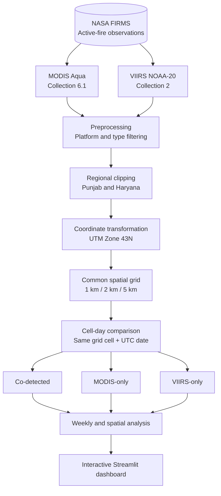

<div align="center">

# 🔥 FIRE PARALLAX

### A Sensor-Aware Burning Activity Calendar

**Two sensors. One region. Different observations.**

[](https://www.spaceappschallenge.org/)
[](https://www.python.org/)
[](https://streamlit.io/)
[](https://firms.modaps.eosdis.nasa.gov/)
[](LICENSE)

**Challenge:** Harmonization of MODIS and VIIRS Hot Spots

**Team ROCHE DOMINION**

</div>

---

## 📑 Table of Contents

- [The Idea](#-the-idea)
- [Key Findings](#-key-findings)
- [The Satellites](#-the-satellites)
- [Explore the Project](#-explore-the-project)
- [Study Region](#-study-region)
- [How It Works](#-how-it-works)
- [Sensitivity Analysis](#-sensitivity-analysis)
- [Technology Stack](#-technology-stack)
- [Project Structure](#-project-structure)
- [Run Locally](#-run-locally)
- [Scientific Limitations](#-scientific-limitations)
- [Documentation](#-documentation)
- [Meet the Team](#-meet-the-team)
- [Acknowledgements](#-acknowledgements)

---

## 🌌 The Idea

> **When two satellite instruments observe the same region, how much of their recorded burning activity overlaps?**

Fire Parallax is an interactive analysis platform comparing active-fire detections from NASA's **MODIS Aqua** and **VIIRS NOAA-20** instruments across Punjab and Haryana, India.

The project addresses the challenge of harmonizing active-fire observations from two satellite systems with different spatial resolutions, observation characteristics and confidence reporting schemes.

Rather than treating every hotspot as a separate physical fire, Fire Parallax places detections onto a common spatial grid and daily timeline.

This creates three comparison categories:

- 🟢 **Co-detected:** Both sensors record qualifying detections in the same spatial cell on the same UTC date.
- 🔵 **MODIS-only:** MODIS records activity in a cell-day where VIIRS does not.
- 🟠 **VIIRS-only:** VIIRS records activity in a cell-day where MODIS does not.

The resulting calendar helps users explore seasonal patterns, spatial overlap, sensor-specific observations and the effect of analytical choices.

**Our objective is to make differences between satellite observations visible, measurable and interpretable.**

---

## 🏆 Key Findings

### Sensor overlap is limited at the cell-day level

| Grid resolution | MODIS cell-days | VIIRS cell-days | Co-detected cell-days | Jaccard overlap |
|:---:|---:|---:|---:|---:|
| 1 km | 11,097 | 46,331 | 1,849 | 3.33% |
| **2 km** | **9,894** | **39,726** | **3,406** | **7.37%** |
| 5 km | 7,656 | 24,472 | 5,166 | 19.16% |

**What these results tell us:**

- At the selected 2 km resolution, the Jaccard overlap is **7.37%**.
- Most recorded cell-days are not shared between the two sensors under the selected matching rule.
- Measured overlap increases as the grid becomes larger.
- Larger cells also increase the possibility of coincidental spatial overlap. Therefore, increasing Jaccard overlap does not, by itself, demonstrate improved agreement or sensor convergence.

Jaccard overlap is calculated as:

\[
J(A,B)=\frac{|A\cap B|}{|A\cup B|}\times100
\]

Where:

- \(A\) represents MODIS cell-days.
- \(B\) represents VIIRS cell-days.
- \(A\cap B\) represents cell-days recorded by both sensors.
- \(A\cup B\) represents cell-days recorded by either sensor.

### Regional observations

After filtering and clipping to the study region:

| State | MODIS Aqua detections | VIIRS NOAA-20 detections |
|:---|---:|---:|
| Punjab | 10,488 | 50,027 |
| Haryana | 782 | 4,776 |
| **Total** | **11,270** | **54,803** |

These are active-fire detection records, not counts of unique physical fires.

### Weekly activity peaks

| State | MODIS Aqua peak week | VIIRS NOAA-20 peak week |
|:---|:---|:---|
| Punjab | 31 October 2022 | 31 October 2022 |
| Haryana | 24 October 2022 | 24 October 2022 |

The weekly peak represents the week with the largest share of that sensor's recorded active cell-days within the selected state and study period.

---

## 🛰️ The Satellites

Fire Parallax compares two satellite-based active-fire observation systems.

| Parameter | MODIS Aqua | VIIRS NOAA-20 |
|:---|:---|:---|
| Instrument | Moderate Resolution Imaging Spectroradiometer | Visible Infrared Imaging Radiometer Suite |
| Platform | NASA Aqua | NOAA-20 |
| Product | Collection 6.1 | Collection 2 |
| Nominal spatial resolution | Approximately 1 km | 375 m |
| Confidence reporting | Numeric confidence | Categorical confidence |

The instruments differ in spatial resolution, observation geometry, overpass timing, detection characteristics and confidence reporting.

Consequently, their raw hotspot counts cannot be interpreted as directly interchangeable measurements.

Fire Parallax preserves these differences as part of the comparison rather than assuming both instruments observe the Earth in exactly the same way.

---

## 🎯 Explore the Project

The Streamlit application provides six interactive sections.

| Section | Function |
|:---|:---|
| 📊 **Overview** | Introduces the study region, sensors and project findings. |
| 🔥 **Burning Activity Calendar** | Displays weekly activity patterns and seasonal distributions. |
| 🗺️ **Spatial Explorer** | Maps co-detected, MODIS-only and VIIRS-only cell-days. |
| 📈 **Sensor Comparison** | Compares recorded activity across Punjab and Haryana. |
| 🔬 **Confidence Explorer** | Explores confidence categories reported by each sensor. |
| 📖 **Methodology** | Explains the processing pipeline, comparison rules and scientific limitations. |

---

## 📍 Study Region

**Punjab and Haryana, India**

The study focuses on the post-monsoon period, when agricultural residue burning is a relevant regional concern.

However, the analysis does not classify detections as confirmed agricultural burning.

| Parameter | Configuration |
|:---|:---|
| Observation period | 1 October – 30 November 2022 |
| Duration | 61 calendar days |
| MODIS dataset | Collection 6.1, Aqua |
| VIIRS dataset | Collection 2, NOAA-20 |
| Detection type | Type 0 — presumed vegetation fire |
| Primary grid resolution | 2 km |
| Additional grid resolutions | 1 km and 5 km |
| Temporal aggregation | Weekly |
| Matching date | UTC acquisition date |
| Projected coordinate system | UTM Zone 43N (EPSG:32643) |

### What does Type 0 mean?

The FIRMS `type` field identifies the general type of active-fire detection.

For this analysis, `type == 0` is selected to retain presumed vegetation-fire detections.

This filter does **not** establish whether a detection represents:

- Agricultural residue burning.
- A forest fire.
- Grassland burning.
- Another vegetation-related thermal event.

The original raw datasets retain the other detection types. The baseline comparison uses Type 0 records only.

---

## 🧬 How It Works



### What is a cell-day?

A **cell-day** represents one spatial grid cell with at least one qualifying detection on a particular UTC date.

The baseline qualifying-detection rules are:

1. MODIS observations are restricted to the Aqua platform.
2. VIIRS observations are restricted to NOAA-20.
3. Both datasets are filtered to `type == 0`.
4. Detections are clipped to the Punjab and Haryana administrative boundaries.
5. Coordinates are transformed into UTM Zone 43N.
6. Detections are assigned to a common spatial grid.
7. Sensor activity is compared using the same grid cell and UTC date.

No additional confidence threshold is applied in the baseline analysis. Original confidence values are retained for separate confidence exploration.

### Cell-day comparison categories

| Category | Definition |
|:---|:---|
| 🟢 Co-detected | Both sensors have at least one qualifying detection in the same grid cell on the same UTC date. |
| 🔵 MODIS-only | MODIS has a qualifying detection, but VIIRS does not under the same matching rule. |
| 🟠 VIIRS-only | VIIRS has a qualifying detection, but MODIS does not under the same matching rule. |

> **Important:** These categories describe satellite observation overlap. They do not establish that both sensors observed the same physical fire or that one sensor missed a verified fire.

---

## 📊 Sensitivity Analysis

The choice of spatial resolution affects the measured overlap between the two datasets.

| Grid resolution | Co-detected cell-days | Jaccard overlap |
|:---:|---:|---:|
| 1 km | 1,849 | 3.33% |
| 2 km | 3,406 | 7.37% |
| 5 km | 5,166 | 19.16% |

The 2 km grid is used as the primary working configuration for the calendar and dashboard.

It is a practical analytical choice, not a universally optimal resolution.

### Additional sensitivity tests

Fire Parallax also investigates:

- **Grid-origin sensitivity:** Tests whether shifting the grid changes the measured overlap.
- **Temporal tolerance:** Compares matching using the same UTC date against wider date windows.
- **High-confidence subsets:** Examines sensor-specific high-confidence detections separately.
- **Directional cross-confidence matching:** Checks whether high-confidence cell-days from one sensor also contain any-confidence detections from the other sensor, in the same state, UTC date and grid cell.
- **State-day overlap:** Examines whether both sensors record activity somewhere within the same state and date.

### Directional cross-confidence findings

At the primary 2 km resolution:

| Direction | High-confidence cell-days | Matched cell-days | Matching rate |
|:---|---:|---:|---:|
| MODIS High → any VIIRS | 1,303 | 585 | 44.90% |
| VIIRS High → any MODIS | 1,297 | 90 | 6.94% |

These rates measure the proportion of high-confidence cell-days from one sensor that also contain at least one detection from the other sensor under the same state, UTC date and grid cell matching rule.

They are **directional spatial-temporal matching rates**, not detection probabilities, accuracy estimates, symmetric agreement scores or evidence that one sensor is superior.

The two instruments use different confidence systems and have different detection characteristics. Their high-confidence categories are not equivalent statistical populations.

These tests measure how comparison outcomes depend on analytical choices. They do not reconstruct physical fire events or establish sensor accuracy.

---

## 🧰 Technology Stack

<div align="center">


</div>

| Layer | Technologies |
|:---|:---|
| Programming language | Python |
| Data processing | Pandas, NumPy |
| Geospatial processing | GeoPandas, Shapely, PyProj |
| Spatial analysis | UTM projection, spatial grids, cell-day matching |
| Visualization | Plotly |
| Application | Streamlit |
| Data source | NASA FIRMS |

---

## 📂 Project Structure

```text
fire-parallax/
│
├── app/
│   ├── __init__.py
│   └── main.py
│
├── assets/
│   └── screenshots/
│
├── data/
│   ├── raw/                 # Original FIRMS downloads (not committed)
│   ├── processed/           # Generated datasets (not committed)
│   └── sample/              # Reserved for sample data
│
├── docs/
│   └── RESULTS.md           # Detailed methodology and results
│
├── src/
│   ├── __init__.py
│   ├── preprocess.py
│   ├── boundaries.py
│   ├── clip_region.py
│   ├── spatial.py
│   ├── make_high_confidence.py
│   ├── grid_analysis.py
│   ├── calendar_analysis.py
│   ├── confidence_calendar.py
│   ├── confidence_summary.py
│   ├── agreement_analysis.py
│   ├── high_confidence_analysis.py
│   ├── date_overlap_analysis.py
│   ├── temporal_tolerance.py
│   ├── grid_origin_sensitivity.py
│   ├── validate_project.py
│   ├── visualize_calendar.py
│   └── visualize_spatial.py
│
├── tests/
│
├── .gitignore
├── requirements.txt
├── LICENSE
└── README.md
```

---

## 🚀 Run Locally

### 1. Clone the repository

```bash
git clone https://github.com/devamayookha/fire-parallax.git
cd fire-parallax
```

### 2. Create a virtual environment

```bash
python -m venv .venv
```

**Windows CMD:**

```cmd
.venv\Scripts\activate
```

**macOS / Linux:**

```bash
source .venv/bin/activate
```

### 3. Install dependencies

```bash
pip install -r requirements.txt
```

### 4. Download NASA FIRMS datasets

Download historical active-fire data from NASA FIRMS using the following configuration:

| Setting | Value |
|:---|:---|
| Date range | 2022-10-01 to 2022-11-30 |
| Bounding box | West 73.7, South 27.5, East 77.9, North 32.6 |
| MODIS | Collection 6.1 |
| VIIRS | Collection 2, NOAA-20 |
| Format | CSV |

Place the extracted files in these locations:

```text
data/
├── raw/
│   ├── modis/
│   │   └── fire_archive_M-C61_846582.csv
│   │
│   └── viirs_noaa20/
│       └── fire_archive_J1V-C2_846583.csv
```

The filenames above correspond to the FIRMS requests used for this analysis.

If you download different files, update the corresponding input paths in the source modules.

### 5. Generate the analysis outputs

Run the modules from the repository root in the following order.

**Core processing pipeline**

```bash
python -m src.preprocess
python -m src.boundaries
python -m src.clip_region
python -m src.spatial
python -m src.make_high_confidence
python -m src.grid_analysis
python -m src.calendar_analysis
python -m src.confidence_calendar
python -m src.confidence_summary
```

**Additional comparison and sensitivity analyses**

```bash
python -m src.agreement_analysis
python -m src.high_confidence_analysis
python -m src.date_overlap_analysis
python -m src.temporal_tolerance
python -m src.grid_origin_sensitivity
```

**Validate the generated outputs**

```bash
python -m src.validate_project
```

The validation module checks expected input record counts, calendar dimensions, confidence summaries, spatial comparison totals, grid-resolution sensitivity, high-confidence overlap and directional cross-confidence matching results.

These checks act as regression checks for the current reference dataset; they do not establish the correctness of the underlying satellite detections.

### 6. Launch the dashboard

```bash
streamlit run app/main.py
```

The application reads its generated datasets from `data/processed/`.

> **Data availability:** Raw and processed datasets are excluded from this GitHub repository. Users must obtain the FIRMS data and generate the processed outputs locally before launching the dashboard. Administrative boundaries are downloaded by the boundary-processing module.

---

## ⚠️ Scientific Limitations

Fire Parallax is an observation-comparison project, not a physical fire reconstruction system.

The following limitations apply:

- Active-fire hotspots are satellite thermal detections, not verified counts of physical fires.
- Type 0 identifies presumed vegetation-fire detections; it does not prove agricultural residue burning.
- MODIS and VIIRS have different spatial resolutions and observation characteristics.
- Their confidence systems are not directly equivalent.
- A missing detection does not establish that no fire occurred.
- Spatial co-detection does not prove that both sensors observed the same physical fire.
- A larger grid can increase apparent overlap through spatial aggregation.
- Temporal tolerance matching does not establish one-to-one physical event correspondence.
- Directional cross-confidence matching does not establish sensor accuracy or detection probability.
- Confidence-class-specific cell-days can overlap when detections with different confidence categories occur in the same cell-day. They must not be summed as unique activity totals.
- The analysis covers one region and one two-month period. Its findings should not be generalized to all locations or seasons.
- The administrative boundary dataset used for the analysis has its own source-date and boundary-accuracy limitations.

The results should therefore be interpreted as differences in recorded satellite observations under specified comparison rules.

---

## 📚 Documentation

For the complete methodology, data processing decisions, numerical results, sensitivity analyses and detailed limitations, see:

**[Detailed Results and Methodology](docs/RESULTS.md)**

---

## 👥 Meet the Team

<div align="center">

# 🔥 ROCHE DOMINION 🔥

| Team Member | GitHub |
|:---|:---|
| **B R Devamayookha** | [@devamayookha](https://github.com/devamayookha) |
| **Kanisha M** | [@kanisha0729](https://github.com/kanisha0729) |

**NASA SPACE APPS CHALLENGE 2026**

</div>

---

## 🙏 Acknowledgements

- **NASA FIRMS (Fire Information for Resource Management System)** for providing active-fire observation data.
- **NASA LANCE (Land, Atmosphere Near real-time Capability for EOS)** and the teams responsible for the MODIS active-fire products.
- **NOAA-20 VIIRS** science and data teams for the VIIRS active-fire observations.
- NASA Space Apps Challenge organizers and mentors.

Data products and their documentation should be consulted for detailed information about collection versions, confidence fields and product characteristics.

---

## 📄 License

This project is released under the [MIT License](LICENSE).

---

<div align="center">

### Because the way we observe Earth matters as much as what we observe.

**Built by ROCHE DOMINION | NASA Space Apps Challenge 2026**

</div>